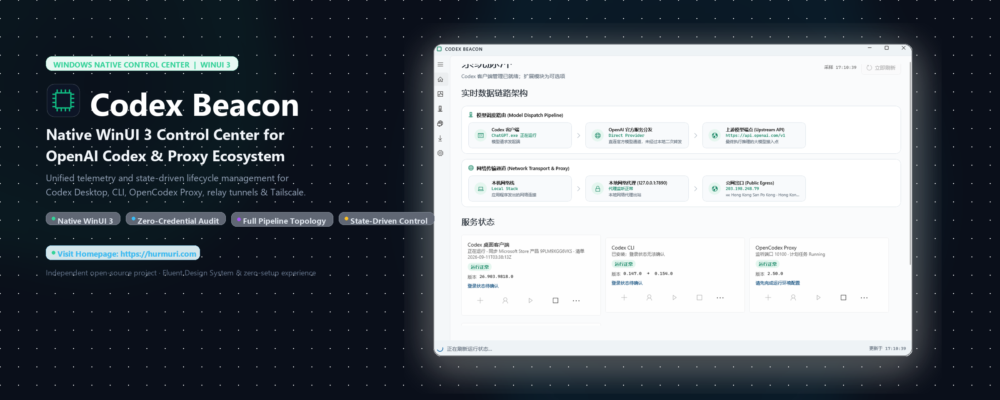

<p align="center">
  <a href="https://hurmuri.github.io/codex-beacon/"></a>
</p>

<h1 align="center">Codex Beacon</h1>

<p align="center">
  <strong>All-in-One Control Center for Codex: Unified orchestration for ChatGPT Desktop and Codex CLI on Windows, with optional Tailscale support.</strong>
</p>

<p align="center">
  <a href="https://hurmuri.github.io/codex-beacon/"><strong>🌐 Official Website: GitHub Pages</strong></a> · 
  <a href="#downloads--quick-run"><strong>⚡ Download Portable Release</strong></a> · 
  <a href="README.zh-CN.md">简体中文说明</a>
</p>

<p align="center">
  <a href="https://hurmuri.github.io/codex-beacon/"></a>
  <a href="https://github.com/hurmuri/codex-beacon/releases"></a>
  <a href="https://github.com/hurmuri/codex-beacon"></a>
  <a href="https://learn.microsoft.com/windows/apps/winui/winui3/"></a>
  <a href="LICENSE"></a>
  <a href="https://github.com/openai/codex"></a>
  <a href="https://tailscale.com"></a>
</p>

Codex Beacon is a native, light-theme WinUI 3 control center for inspecting and managing the Codex desktop app, Codex CLI, Node.js/NVM/npm, and Tailscale on Windows.

Codex Beacon supports English and Simplified Chinese. It follows the Windows display language by default, and the language can be changed under Settings. `build/version.txt` is the single version source and increments on every build; the running version is always shown under Settings → About & update. The Codex desktop app and CLI are core features; Tailscale is an independent optional module. Installing an extension never changes the active Codex routing automatically.

## About

Codex Beacon is an open-source system manager designed specifically for developers using OpenAI Codex on Windows. As the local AI development toolchain expands, developers frequently coordinate multiple distinct services: the official Codex desktop client (`OpenAI.Codex`), CLI utilities, specific Node.js versions, and Tailscale virtual private networks.

Before Codex Beacon, monitoring and managing these components required juggling Task Manager, multiple PowerShell windows, npm CLI commands, and configuration files. Codex Beacon solves this by bringing everything together into a cohesive, Windows-native desktop application.

### Key Highlights

- **Windows Native & Modern**: Crafted exclusively with WinUI 3, Windows App SDK 1.8, and Fluent Design System guidelines. Lightweight, clean, high-contrast light theme without web-wrapper overhead.
- **No Stored Credentials**: Codex Beacon stores no API keys, tokens, or passwords. Diagnostics, logs, exports, and status text never contain credential material.
- **State-Driven Workflow**: Every action (install, sign in, start, stop, restart, upgrade) is strictly bounded by component status—preventing accidental duplicate instances or broken configurations.
- **Modular & Non-Intrusive**: Codex desktop and CLI are core; Tailscale is a purely optional extension. A missing extension never degrades core system status.
- **Bilingual & Instant Switching**: Seamlessly supports English and Simplified Chinese with instant, in-app UI switching without requiring process restarts.
- **Self-Updating**: Checks the official GitHub release feed, shows a banner when a newer build exists, streams the download with progress and a SHA-256 check, then replaces the install package in place and restarts into the new version.

## Upstream projects

- [Codex CLI · openai/codex](https://github.com/openai/codex)
- [NVM for Windows](https://github.com/coreybutler/nvm-windows)
- [Node.js](https://github.com/nodejs/node) and [npm CLI](https://github.com/npm/cli)
- [Tailscale](https://github.com/tailscale/tailscale)

## Implementation references

- [Wangnov/Codex-App-Manager](https://github.com/Wangnov/Codex-App-Manager): reference for Codex desktop version discovery and management.
- [v2fly/domain-list-community](https://github.com/v2fly/domain-list-community): reference for network-domain classification. Its rules are not bundled or read by the current release.

## Implemented

- Separate version, process, sign-in, and update detection for the Codex desktop app and Codex CLI. Each executable's version is read from its own install source (npm global, `PATH`, or the copy bundled with the desktop app), so several different versions can coexist on one machine.
- Local/latest version comparison for `@openai/codex` using the official npm registry.
- State-driven actions per component (install, sign in, start, stop, restart, upgrade), each disabled until its own prerequisites are proven.
- NVM for Windows detection, installed Node.js inventory, version installation, and active-version switching.
- Node.js downloads use a configurable mirror and fall back to the official host automatically, so an unreachable `nodejs.org` can no longer stall an install.
- Node.js ≥ 22.14.0 and npm prerequisite checks before npm-based modules can be installed.
- Effective network route detection that reports whether Codex currently uses the Windows system proxy, a TUN adapter, a custom HTTP proxy, environment proxy variables, or a direct connection.
- Public egress reported from OpenAI's point of view, enriched with country, region, city, ISP, AS number, hosting/proxy classification, and a trust score.
- Tailscale service, local node, Tailnet device, address, online, and last-seen status.
- Allowlisted bulk recovery that excludes Codex Beacon, the ChatGPT desktop app, and unrelated Node.js processes.
- One append-only application log collects action output, installer progress, launcher messages, and errors, with secrets redacted before a line is written. It opens in a dedicated window with copy-all and open-folder actions.
- Closing the window hides Codex Beacon to the system tray, where it keeps running until Exit is chosen. A Windows startup setting registers the app with `--background` so it starts into the tray after sign-in.
- Long-running actions stream native tool output and can be cancelled, and every action has a hard timeout so the window never appears frozen.
- English and Simplified Chinese UI, diagnostics, action results, and instant in-app language switching.
- Every build bumps its own version from `build/version.txt`, so each compiled artifact carries a distinct version.
- In-app updates against the official GitHub Releases channel: version check, prompt on startup, manual check, streamed download with progress and speed, SHA-256 verification, skip-this-version, and an in-place restart into the new build.

## Core Functional Modules

Codex Beacon is built around six modular, state-driven destinations:

1. **Codex Dashboard**: Dual-core visibility for official Microsoft Store ChatGPT (`OpenAI.Codex`) and global npm `@openai/codex` CLI. Compares local builds against upstream npm registry metadata.
2. **Dependencies & NVM**: Automatic NVM for Windows detection, Node.js version switching (satisfying the Codex CLI Node.js >= 22.14.0 prerequisite), and mirror acceleration with automatic fallback.
3. **Process Arbiter**: Real-time inventory of all related processes (PID, role, executable version, start time, executable path) with a strict termination whitelist that prevents killing host apps or unrelated Node.js workflows.
4. **Network & Egress**: Effective proxy route detection (system proxy, TUN, custom HTTP proxy, environment proxy, direct) and true public egress IP probing with automatic Residential vs Datacenter tagging to avoid OpenAI 403 blocks.
5. **Tailscale Mesh (Optional Extension)**: Local Tailscale daemon inspection, virtual IP discovery, and remote node inventory for private GPU computing.
6. **Settings & Self-Updating**: Version telemetry, instant English/Chinese bilingual switching, and in-place GitHub Releases self-updates with SHA-256 verification.

## Download and run

### One-Liner PowerShell Quick Start

```powershell
irm https://hurmuri.github.io/codex-beacon/install.ps1 | iex
```


Each GitHub Release provides two versioned, standalone single-file x64 executables (no zip archives required; download and run directly):

| File | Best for | Runtime requirements |
| --- | --- | --- |
| `CodexBeacon-<version>.exe` | [Recommended] Standalone portable edition, out-of-the-box | Self-contained with bundled .NET 10 runtime & Windows App SDK |
| `CodexBeacon-<version>-slim.exe` | [Lightweight] Standalone slim edition, minimal size | Requires pre-installed [.NET 10 Desktop Runtime x64](https://dotnet.microsoft.com/download/dotnet/10.0) |
| `SHA256SUMS.txt` | SHA-256 checksums for both executables | — |

No archive step is required. On first run the launcher expands its embedded payload into `%LOCALAPPDATA%\CodexBeacon\app-portable` and starts the manager from there. The in-app updater depends on this layout: it downloads the matching single-file build, replaces that launcher in place, and relaunches it, after which the refreshed launcher re-expands its payload.

Windows does not include .NET 10 or the required Windows App Runtime by default; choose the `portable` build when unsure.

Both builds require x64 Windows 10 1809 (build 17763) or later. Status collection uses Windows PowerShell 5.1, which is included with supported Windows versions. Unsigned community builds may trigger Windows SmartScreen. Network access is used for version checks, official installers, sign-in, and public-egress discovery.

Node.js, npm, NVM, and Tailscale are not prerequisites for launching Codex Beacon. They are required only for their corresponding management features. The UI detects missing dependencies and guides users through install → sign in → start. The Codex CLI requires Node.js and npm, and Node.js 22.14.0 or newer.

The Portable single-file executable is currently about 126 MB and the Slim one about 92 MB. The expanded self-contained directory is about 216 MB and compresses to about 87 MB. Most of that size comes from the bundled .NET 10 runtime, WinUI 3 / Windows App SDK, DirectML, and ONNX Runtime components.

## Build from source

Building requires x64 Windows 10 1809 or later and the .NET 10 SDK.

The authoritative dual single-file packaging and release workflow is documented in [PACKAGING.md](PACKAGING.md).

```powershell
dotnet build .\CodexBeacon.csproj -c Release
dotnet run --project .\CodexBeacon.csproj
```

Create a self-contained directory:

```powershell
dotnet publish .\CodexBeacon.csproj -c Release -r win-x64 --self-contained true -p:WindowsAppSDKSelfContained=true -o .\publish\win-x64
```

## Permissions and safety boundaries

### Standard Non-Admin Mode (Recommended)

Codex Beacon is designed to run **without administrator privileges** by default:
- Live detection of Codex desktop and CLI status plus the effective network route;
- Querying public egress IP, geographical location, ISP, and outbound proxy type;
- Inspecting all running Codex and ChatGPT processes, with one-click termination and app restart;
- Detecting NVM and Node.js runtime environments.

### Operations Requiring Administrator Privileges

The following specific actions may require UAC elevation on Windows:
1. **Tailscale System Service Control**: Starting, stopping, or restarting the Tailscale Windows service requires administrative access;
2. **NVM Global Version Switching (Protected Paths)**: If NVM creates symlinks under protected directories such as `C:\Program Files\nodejs`, switching versions requires administrator rights (unrestricted if NVM is installed under a user path);
3. **System Scheduled Tasks**: Registering or updating tasks running under system service accounts.

Codex Beacon never elevates silently. When an operation fails due to insufficient privileges, it provides an actionable error message prompting the user to restart as administrator if needed.

- Diagnostics never read or display tokens, authorization headers, passwords, cookies, or API keys. Codex Beacon stores no credentials at all, so no key material can leak into diagnostic collection or export.
- The machine's public egress IP is never presented as a remote service IP. The two are distinct concepts, and the UI only reports the public egress.
- The installed Codex desktop version comes from the local `OpenAI.Codex` MSIX/AppX package. The latest Windows package version comes from the Codex App Mirror manifest, which mirrors Microsoft Store product `9PLM9XGG6VKS`. The UI identifies that source, while installation and upgrades always open the official Microsoft Store page.

See [CONTRIBUTING.md](CONTRIBUTING.md), [DESIGN.md](DESIGN.md), [SECURITY.md](SECURITY.md), and the [MIT license](LICENSE).

## Local adaptation

The Network page only includes an endpoint in the active path when it is backed by observed runtime evidence:


The Network page reports the effective transport route independently of any extension: Windows system proxy, TUN adapter, custom HTTP proxy, environment proxy variables, or a direct connection.
